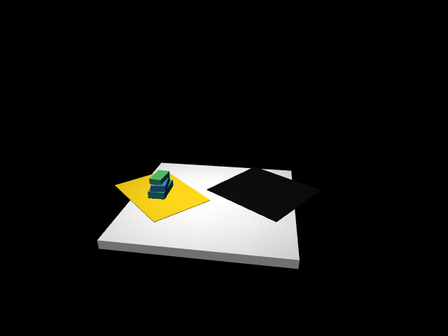

# Phase 0: Environment check

Date: 2026-10-20. Status: **Mac done; GPU machine waiting on you running one script.**

## 1. Machines

| | Mac (arm, cameras, game) | GPU machine (training) |
|---|---|---|
| OS | macOS 14.6 (23G80), arm64 | Windows + WSL2 Ubuntu: **pending** (`scripts/gpu_env_check.sh`) |
| CPU | Apple M3, 8 cores (4P + 4E) | pending |
| RAM | 16 GB | pending |
| GPU | M3 10-core GPU, Metal 3; torch MPS available | RTX 3080, **10 vs 12 GB pending** (`nvidia-smi`) |
| Disk | 116 GB free of 460 GB | pending |
| ffmpeg | 8.0.1 (Homebrew) | pending |

The GPU machine has no SSH entry on this Mac (only `samrobot`, `robodog`, `github.com`),
so I can't check it myself.

## 2. Sim environment (Mac)

- New, separate env: `~/.venvs/so101_stack_sim` (uv, CPython 3.12.6). Not inside the
  LeRobot env, as Working rule 2 requires. Pinned list: `scripts/requirements-sim.txt`.
- **MuJoCo 3.16.0**, numpy 2.5.4, pillow, pyyaml, matplotlib, opencv-python-headless.
- Recreate with:
  ```
  uv venv --python 3.12 ~/.venvs/so101_stack_sim
  VIRTUAL_ENV=~/.venvs/so101_stack_sim uv pip install -r scripts/requirements-sim.txt
  ```

### Offscreen rendering: works, backend = `cgl`

Valid backends come from the installed source,
`mujoco/rendering/classic/gl_context.py:24-53`: on Darwin they are `cgl` and `glfw`. With
`MUJOCO_GL` unset it tries `cgl` first and falls back to `glfw`.

`scripts/env_check.py` builds a placeholder scene (white table, yellow pad, black mat,
the three box sizes and masses dropped into a stack), steps physics for 1 s, then renders
the `front` camera at 640×480:

| MUJOCO_GL | result | render 640×480 | physics (tiny scene) |
|---|---|---|---|
| `cgl` | OK, non-blank | 1.9 ms/frame (~520 fps) | ~80k steps/s |
| `glfw` | OK, non-blank | 2.0 ms/frame | ~90k steps/s |
| unset | OK (uses `cgl`) | 1.7 ms/frame | ~87k steps/s |

**Decision: use `MUJOCO_GL=cgl` on the Mac** (headless, no window).



`notes/img/phase0_render_cgl.png`. I looked at it: the yellow area is on the left and
the black mat on the right, as in `front_cam_frame.png`. Framing and FOV don't match yet;
that's Phase 3. The first run produced black frames on every backend. The cause was a
wrong sign in my hand-written camera `xyaxes`, which pointed the camera away from the
table, not a GL fault. It now uses `mode="targetbody"` on a look-at body.

Physics sanity check: the 3-box stack settles with the top box centre at 3.99 cm against
3.95 cm expected (1.7 + 1.6 + 0.65). The 0.4 mm gap comes from default soft-contact
settings; Phase 4 tunes solref/solimp.

**Throughput estimate (rough, for planning Phase 5):** one ~12 s episode at 30 fps is 360
steps × 2 cameras = 720 renders ≈ 1.5 s of rendering. Arm physics with contacts and video
encoding will add more. Guess: a few seconds per episode per process, so 2,500 episodes
take a few hours on one core and less in parallel. I'll measure this properly in Phase 5.

## 3. LeRobot on the Mac (read-only check, nothing changed)

- conda env `lerobot` (`/opt/anaconda3/envs/lerobot`), Python 3.12.15
- LeRobot **0.6.2**, editable from `~/lerobot`, branch `main`, commit **`ca69a206`**
  (2026-10-07, "feat(datasets): disk-less episode-pool video streaming (#3917)")
- torch 2.11.0, MPS available
- That env also has mujoco 3.8.1. It isn't used for sim work, and I won't mix the two
  (the sim env runs 3.16.0).
- Source paths for Phase 1 exist: `src/lerobot/robots/so_follower/` (`so_follower.py`,
  `config_so_follower.py`), `src/lerobot/motors/feetech/`.

**Version alignment to watch:** datasets must be written with the WSL LeRobot version
(Working rule 2), and the trained policy will be loaded on the Mac for real runs. The
WSL commit should therefore match `ca69a206`, or at least be close enough that
policy/config formats load on both. The GPU script prints the WSL commit.

## 4. Prior `so101_sim/` work

**Not found on the Mac.** I searched `~` to depth 5 for `so101_sim`, `joint_mapping.py`,
`*.urdf`, and SO-101 MJCF/scene files. There's no MuJoCo model, URDF or joint mapping
anywhere. The FK behind `measurements.yaml` (with `so101_new_calib.urdf`) must have run
somewhere else.

Reusable as validated: **nothing**. Phase 1 starts from the official SO-101 model
(TheRobotStudio SO-ARM100, with MuJoCo Menagerie as reference) and builds
`joint_mapping.py` from scratch. **Question:** is `so101_sim/` on the Windows/WSL
machine? The GPU script doesn't search for it, so please check (`ls ~/so101_sim` in WSL,
and your Windows user folder).

### Helper scripts (Mac, in `~/lerobot/`, untracked)
Found: `so101_go_home.py`, `so101_rollout_loop.py`, `so101_capture_frames.py`,
`so101_record_points.py`, `so101_pan_zero.py`, `so101_keyboard_teleop.py`,
`so101_keyboard_record.py`. Duplicate copies are in `~/Downloads/`.
**Missing:** `so101_start_poses.py` and `so101_grasp_poses.py`, which CLAUDE.md lists
(dataset analysis only, so they don't block anything).
Home pose file `~/.cache/so101_home/my_follower_arm.json` is present and matches
`measurements.yaml` `home_pose`.
In the project: `scripts/so101_record_video.py`.

## 5. Inputs inventory (against CLAUDE.md Section 5)

| Item | Status |
|---|---|
| `measurements.yaml`, `table_points_*.json`, `calibration/my_follower_arm.json` | present |
| `photos/front_cam_frame.png`, `front_cam_stack3.png`, `topdown.jpg`, `side.jpg`, `box_closeup.jpg`, `gripper_open.jpg` | present |
| `photos/box_faces/{no3,no35,no10}/` × 6 faces | present (18 files) |
| `photos/wrist_cam_frame.png` | **missing**. `measurements.yaml` refers to it; Phase 3 needs it to fit the wrist camera |
| `photos/table_tape_areas.jpg` | **missing** (`topdown.jpg` may be enough) |
| `photos/gripper_closed.png` | extra, not in the list |
| `videos/stack_collapse.mp4`, `human_turn.mp4` | present |
| `stability/overhang_tests.yaml` | present (filled in) |

Noticed in passing for Phase 2 (not acted on): `measurements.yaml` says `contents: full`
for every box, which resolves the "full vs empty" TODO pending your confirmation. It also
says the yellow base needs no contrast fix; upper stack boxes against the white
table/panel are still open (Section 3a).

## 6. Repo hygiene (needs your call)

`so101_stack_game/` isn't its own git repo. The enclosing repo is your **home directory**
(`/Users/maxchan/.git`), with everything untracked and no commits. Committing from here
would go into that home-dir repo. I suggest `git init` inside `so101_stack_game/` with a
`.gitignore` covering `data/`, `.DS_Store` and large outputs. I haven't changed anything.

## 7. What you need to run on the GPU machine

Copy the project's `scripts/` folder into WSL (for example to `~/so101_stack_game/scripts/`),
then in WSL Ubuntu:

```
bash ~/so101_stack_game/scripts/gpu_env_check.sh 2>&1 | tee ~/gpu_env_check.txt
```

It is read-only for the `lerobot` conda env. It prints OS, cores, RAM, `.wslconfig`,
`nvidia-smi` (10 vs 12 GB), the LeRobot version and git commit, torch/CUDA with a CUDA
matmul, av/torchcodec/ffmpeg, and then tries MuJoCo offscreen rendering with `egl`,
`osmesa` and `glfw` in a **separate** venv `~/.venvs/so101_stack_sim`. Paste the output
(or put `gpu_env_check.txt` in `inputs/`).

Plan depending on the result:
- Data generation and rendering run on the **Mac** either way (CGL works and is fast).
  Raw episodes are copied to WSL, and `export_lerobot.py` runs there in the `lerobot` env.
- If WSL EGL works, `sim_eval.py` (policy + rendering) can run on the 3080. If it
  doesn't, run sim eval on the Mac (MPS) or on native Windows (`MUJOCO_GL=wgl`).

## Open issues
1. GPU machine report (script above).
2. Is `so101_sim/` on the Windows/WSL machine?
3. `wrist_cam_frame.png` is missing; needed by Phase 3.
4. Git: init a project-local repo?

## Next step
After your OK: Phase 1, robot model and joint mapping.
