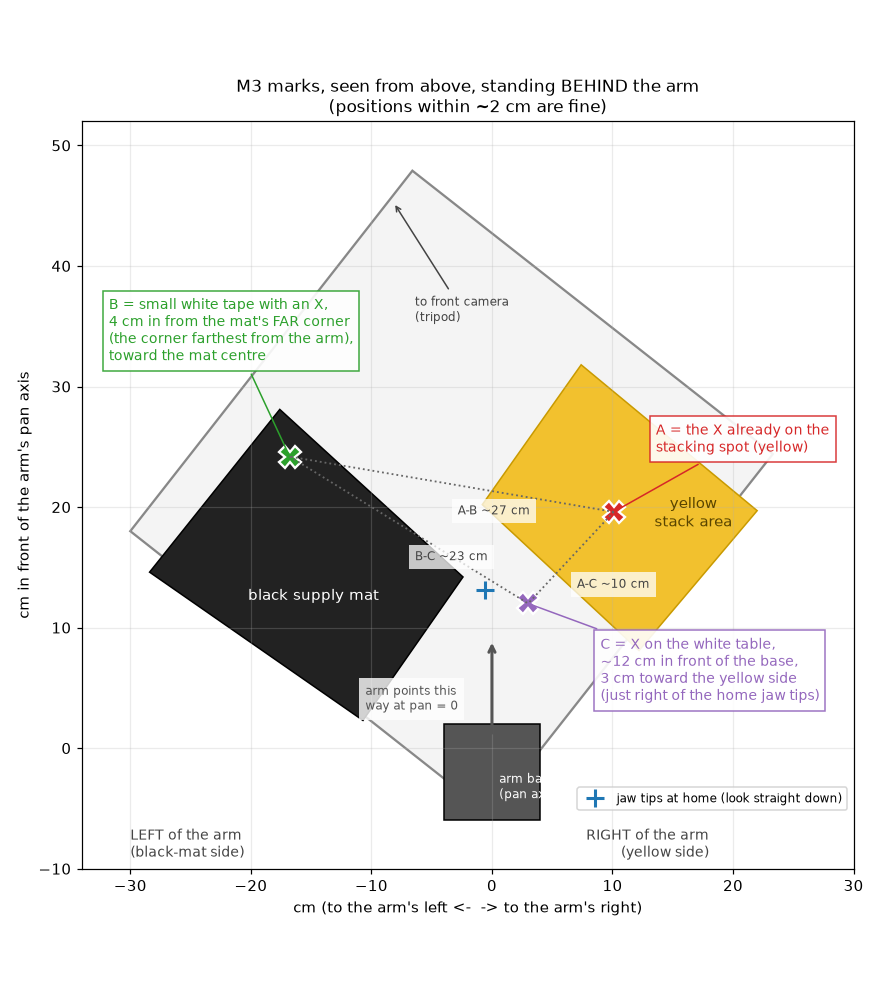
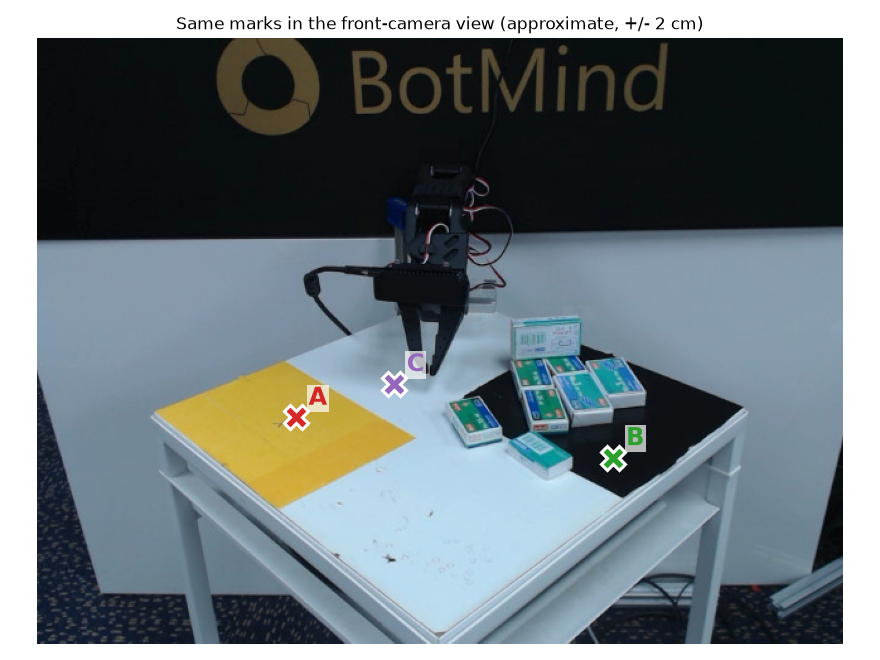

# Phase 1 real-arm measurements: step-by-step guide (M2, M3, M4)

M1 is done: the jaw tips are **2.4 cm** above the table at home
(`notes/phase1_measurements.yaml`). That rules out the plain mapping (it predicts the tips
2.5–9 mm *below* the table) and agrees with the fitted offsets (shoulder_lift ≈ −7°,
elbow ≈ +4.5°, base tilt ≈ 1.6°), which match 24 mm exactly.
Log: `notes/phase1_logs/phase1_touch_fit.txt`, last section.

What's left, and why:

| | what | why | time |
|---|---|---|---|
| M2 | phone-level readings of the table and the arm base | measures whether the arm sits tilted on the table. The touches can't tell "base leans forward" apart from "shoulder_lift offset" | 5 min |
| M3 | touch 3 marks, each at 3 wrist angles, plus 3 ruler distances | pins shoulder_lift, elbow and wrist offsets to about ±1° | 20–25 min |
| M4 | drive to 3 test poses and photograph each | independent visual check, and fixes the wrist_roll direction | 10 min |

Clear all boxes off the table first; M3 and M4 both need an empty table.

---

## M2: Is the arm sitting tilted on the table?

> **Result 2026-10-20: every reading showed 0°.** A whole-degree phone display means each
> surface is within about ±0.5° of level, so the base is within about 1° of the table. That
> is enough: it's used as a front-back prior of 0 ± 0.5°, and with your mark layout M3 then
> gives shoulder_lift, elbow and wrist to about ±1.1°
> (`phase1_logs/phase1_protocol_sim_user_layout_coarse_level.txt`). The side-to-side tilt
> is left for M3 to measure (±0.5–0.7°). The touch data suggested ~1.5° there, and if M3
> confirms that despite the level, the "tilt" is inside the arm (e.g. the pan axis), not
> how the base sits. The sim models both the same way.

**The idea.** If the arm's base isn't perfectly parallel to the table, every reach toward
one side ends up a bit lower than the same reach toward the other side. Your touch data
suggests about **1.5°**: the table seems to rise toward the arm's left (black-mat side),
roughly 2.5 mm per 10 cm. A phone level measures this directly, in seconds.

**Tool:** iPhone **Measure app → Level** tab (or any level app). Lay the phone on its
**long edge**: it then shows the tilt along its length in degrees, and the screen shows
which end is lower.

**Directions, as seen standing behind the arm:**
- **left-right** = from the black mat across to the yellow area
- **front-back** = the direction the arm points at pan = 0, toward the front camera's tripod
  (see `notes/img/phase1_marks_topdown.png`)

**Readings:**
1. **Table, left-right:** phone on its long edge on the white table between the arm and
   the mats, running left-right. Write down the angle and **which end is lower** (left or
   right).
2. **Table, front-back:** same spot, phone turned 90° to run front-back. Angle, plus
   whether the **front or back** end is lower.
3. **Arm base, left-right:** the same two readings on a flat surface that is rigidly part
   of the arm's base. Best is the flat top of the base housing beside the rotating
   shoulder. If no spot is long enough for the phone's edge, use the top of the aluminium
   extrusion the base is bolted to.
4. **Arm base, front-back.**

If neither surface fits the phone, lay the phone **flat** on the biggest flat spot of the
base with its top pointing front, and send a **screenshot** of the level screen; the
offset circles show the direction. If there's no usable surface at all, skip M2. M3 still
works, but shoulder_lift ends up ±1.8° instead of ±1.1°.

Report as, for example: `table LR 0.3° right low, table FB 0.1° front low, base LR 1.8° left low, base FB 0.5° back low`.

---

## M3: Touch three marks with different wrist angles

**The idea.** In the old touches the wrist never moved (62.8° every time), so wrist,
elbow and tilt errors could cancel each other out. If you touch the **same** spot several
times with the wrist bent differently, the only model that puts all those touches on the
same spot is the one with the right offsets.

### Where the marks go





- **A**: the **X already on the stacking spot** in the yellow area. Nothing to add.
- **B**: a small piece (~1.5 cm) of **white tape on the black mat** with a pen X on it.
  Place it **4 cm in from the mat's far corner** (the mat corner farthest from the arm,
  which is the one nearest the camera tripod), toward the middle of the mat. In the
  front-camera view that's the mat's bottom corner.
- **C**: a small X on the **white table** (pencil or a small piece of tape). Place it about
  **12 cm in front of the arm base** and 3 cm toward the yellow side. Easy way to find it:
  send the arm home, look straight down from above the jaw tips, then go about **3 cm
  toward the yellow area**. It's in the white gap between the two mats.

Exact positions don't matter (anywhere within about 2 cm is fine). The fit solves for
where the marks are. What it needs is:
- **ruler distances, centre of X to centre of X, in mm:** A–B (~27 cm), B–C (~23 cm),
  A–C (~10 cm)
- **marks that stay put** for the whole session

### Touching

Same keys and touching style as your earlier table points: jaws closed (hold `h`), jog,
barely touch, don't press, `p` to record, `k` to skip, `u` to undo.

```
conda activate lerobot
cd ~/so101_stack_game
python scripts/so101_record_points.py --port /dev/tty.usbmodem5B910311481 --id my_follower_arm --points multipose --out inputs/multipose_points.json
```

The script asks for 9 touches in this order: A steep, A mid, A flat, B steep, B mid,
B flat, C steep, C mid, C flat.

- **steep:** jaws pointing (nearly) straight down onto the X.
- **mid:** wrist bent so the jaws lean about **30°** from vertical. Keep the tips on the X;
  you'll need to re-adjust shoulder_lift and elbow (w/s, e/d) as the wrist (r/f) changes.
- **flat:** lean about **50°**, or as far as the arm can while the tips still touch the X.

Which way the jaws lean doesn't matter. At A and B the easy way is jaws leaning **away**
from the arm, like reaching forward. At C (close to the arm) it's jaws leaning **toward**
the arm, and only about 30° is reachable, so do steep, about 15°, and about 30° there.

Skip (`k`) any touch the arm can't reach. **All that matters is that the three wrist
angles at each mark differ by at least ~20°.**

When done, send `inputs/multipose_points.json` and the three ruler distances.

---

## M4: Three test poses with photos

**The idea.** I drive the arm to joint angles I chose, and you photograph it with the
`front` and `wrist` cameras. I then render the sim at the same angles and compare.
- **P1** and **P2** check the mapping away from home.
- **P3** is P1 with **only** wrist_roll turned by +45°. The direction the jaws turn between
  P1 and P3 in the photos shows the sign of the wrist_roll offset (the ±90° question from
  the home image).

**What the commands do.** `so101_go_home.py --home-file X.json` reads the six joint
targets in `X.json` and moves every joint toward its target at no more than 15°/s. When it
arrives it keeps torque on and holds the pose. **Ctrl-C stops the motion at once**, and
the arm holds where it stopped. Every move goes through **`R_raise`**: your home pose with
only the elbow unfolded to 45°, which lifts the gripper about 20 cm (up and slightly
forward) before anything swings sideways. I simulated every move exactly as this script drives it, both
directions, under all five hypotheses still open. The lowest point of the gripper stays
**at least 10.6 cm above the table** away from home. Not simulated: the arm hitting
itself, and cables, so watch the first move.

**Before you start:** table cleared of boxes, nothing near the arm, cables hanging free,
tripod untouched. Run everything from `~/so101_stack_game` with the `lerobot` env active.
`PORT=/dev/tty.usbmodem5B910311481`.

| step | command | what you should see |
|---|---|---|
| 0 | `python scripts/so101_go_home.py --port $PORT --id my_follower_arm --speed 15` | arm at home (start position) |
| 1 | `python scripts/so101_go_home.py --port $PORT --id my_follower_arm --speed 15 --home-file notes/phase1_poses/R_raise.json` | only the elbow moves; gripper rises ~20 cm, up and slightly forward (~4 s) |
| 2 | `python scripts/so101_go_home.py --port $PORT --id my_follower_arm --speed 15 --home-file notes/phase1_poses/P1_over_stack.json` | arm swings to its right; gripper ends ~12 cm above the yellow X, jaws open ~6 cm at the tips, pointing mostly down (~5 s) |
| 3 | `python scripts/so101_capture_frames.py --cameras front=0 wrist=1 --out inputs/photos/phase1 --suffix P1` | saves `inputs/photos/phase1/front_cam_P1.png` and `wrist_cam_P1.png` |
| 4 | same as step 1 (back to `R_raise`) | |
| 5 | `... --home-file notes/phase1_poses/P2_side_raised.json` | arm turns to its left over the black mat, raised high; gripper ~23 cm above the table, jaws closed |
| 6 | `python scripts/so101_capture_frames.py --cameras front=0 wrist=1 --out inputs/photos/phase1 --suffix P2` | |
| 7 | same as step 1 (back to `R_raise`) | |
| 8 | `... --home-file notes/phase1_poses/P3_over_stack_roll45.json` | same place as P1, but the gripper is turned 45° about its own axis |
| 9 | `python scripts/so101_capture_frames.py --cameras front=0 wrist=1 --out inputs/photos/phase1 --suffix P3` | |
| 10 | same as step 1 (back to `R_raise`) | |
| 11 | step 0 again (home) | |

`...` = `python scripts/so101_go_home.py --port $PORT --id my_follower_arm --speed 15`.

**Stop with Ctrl-C** if anything heads toward the table, the arm, a cable or the tripod,
or if a motor sounds strained. Then tell me where it stopped; don't continue the sequence.

**Optional:** if you notice whether the jaws turned clockwise or counter-clockwise going
into P3 (seen from the camera side), tell me. Otherwise I'll read it from the photos.

---

## What happens with the results

1. Fit offsets and tilt from M2 + M3, then check the fit against M1 (2.4 cm) and the old
   13 touch points.
2. Render the P1–P3 sim views with the fitted mapping and compare them with your photos;
   P1 vs P3 settles wrist_roll.
3. Set `sim/assets/joint_mapping.yaml` to `status: validated`, then on to Phase 2.
